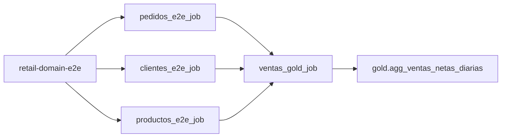

# Retail Domain Orchestration (`retail_orchestration`)

## 1. Propósito y Ownership

Este Bundle administra el workflow de orquestación de extremo a extremo para el dominio **Retail** (`retail-domain-e2e`). Su función es coordinar la ejecución paralela de los productores (`pedidos`, `clientes`, `productos`) y asegurar la invocación sincronizada de la capability consumidora (`ventas`) únicamente cuando las tres fuentes upstream hayan finalizado exitosamente.

### Owners
- **Owner Técnico del Dominio Retail**: Equipo de Dominio Retail (`retail-domain` / `@becavas`).
- **Owner de Data Platform**: Data Platform Engineering (`data-platform` / `@becavas`).
- **Owners de Capabilities Upstream / Downstream**:
  - `pedidos`: Capability Lead Pedidos ([README](../capabilities/pedidos/README.md))
  - `clientes`: Capability Lead Clientes ([README](../capabilities/clientes/README.md))
  - `productos`: Capability Lead Productos ([README](../capabilities/productos/README.md))
  - `ventas`: Capability Lead Ventas ([README](../capabilities/ventas/README.md))

---

## 2. DAG del Dominio



### Justificación de Dependencias y Paralelismo
- **Paralelismo**: `pedidos`, `clientes` y `productos` procesan entidades disjuntas desde landing/bronze hasta silver en Unity Catalog. No poseen dependencias cruzadas entre sí y se ejecutan en paralelo para optimizar el tiempo total de ingestión.
- **Fan-in hacia Ventas**: `ventas` consume las 5 tablas Silver curadas (`pedidos_curated`, `pedido_items_curated`, `clientes_curated`, `productos_curated`, `categorias_curated`) para construir dimensiones Gold, hechos y KPIs reconciliados. Por tanto, `run_ventas` depende estrictamente del éxito simultáneo de `run_pedidos`, `run_clientes` y `run_productos`.

---

## 3. Nombres Lógicos y Efectivos por Target

El orquestador no hardcodea IDs numéricos ni crea copias de los Jobs. Resuelve los Job IDs en tiempo de `validate` / `deploy` mediante lookups de nombres efectivos únicos:

| Capability | Recurso Lógico | Target Sandbox (Development) | Variable de Lookup |
|---|---|---|---|
| `pedidos` | `pedidos_e2e_job` | `[dev ${workspace.current_user.short_name}] retail-pedidos-e2e` | `${var.pedidos_job_name}` |
| `clientes` | `clientes_e2e_job` | `[dev ${workspace.current_user.short_name}] retail-clientes-e2e` | `${var.clientes_job_name}` |
| `productos` | `productos_e2e_job` | `[dev ${workspace.current_user.short_name}] retail-productos-e2e` | `${var.productos_job_name}` |
| `ventas` | `ventas_gold_job` | `[dev ${workspace.current_user.short_name}] retail-ventas-gold` | `${var.ventas_job_name}` |

---

## 4. Contrato de Parámetros

| Parámetro Parent | Default | Propagación a Children | Descripción |
|---|---|---|---|
| `batch_id` | `domain_valid_001` | `run_pedidos`, `run_clientes`, `run_productos`, `run_ventas` | Identificador único del lote común para trazabilidad de dominio |
| `snapshot_mode` | `INCREMENTAL` | Exclusivo para `run_ventas` | Modo de resolución de dimensiones (`FULL` o `INCREMENTAL`) |
| `aggregate_mode` | `INCREMENTAL` | Exclusivo para `run_ventas` | Modo de agregación del KPI (`FULL` para baseline/rebuild o `INCREMENTAL`) |

---

## 5. Concurrencia, Límites y Tiempos Máximos

- **`max_concurrent_runs`**: `1` (evita colisiones o mutaciones cruzadas sobre los mismos batches).
- **`queue.enabled`**: `true` (las ejecuciones concurrentes adicionales esperan en cola en lugar de descartarse).
- **`timeout_seconds` del Parent**: `14400` (4 horas límite total de orquestación).
- **Timeouts de Tasks**:
  - `run_pedidos`, `run_clientes`, `run_productos`: `3600` segundos (1 hora).
  - `run_ventas`: `5400` segundos (1.5 horas para dimensiones, hecho y KPIs).
- **Parent Retries**: `max_retries: 0` (las fallas de datos detienen el DAG y exigen diagnóstico e intervención consciente mediante repair-run).

---

## 6. Permisos e Identidades Requeridas

- Para desplegar y validar el Bundle: Permisos de lectura de workspace y Jobs en el entorno de desarrollo.
- Para ejecutar (`bundle run`) o reparar (`repair-run`): Se requiere permiso mínimo **`CAN MANAGE RUN`** sobre los child Jobs de las cuatro capabilities.
- **Run as**: Cada child Job se ejecuta con su propia identidad configurada (en sandbox, la del alumno), la cual debe contar con privilegios `USE CATALOG`, `USE SCHEMA`, `SELECT`, `MODIFY` sobre los esquemas de Unity Catalog correspondientes.

---

## 7. Procedimiento de Ejecución y Reparación (Repair Runs)

### Ejecución Estándar E2E
```bash
databricks bundle run retail_domain_e2e_job \
  --target sandbox \
  --profile sandbox \
  --params batch_id=<batch_id>,snapshot_mode=INCREMENTAL,aggregate_mode=INCREMENTAL
```

### Diagnóstico ante Falla Parcial
Si un productor upstream falla (ej. `run_productos` debido a datos inválidos en landing):
1. El parent Job detiene el flujo: `run_productos` marca `FAILED`.
2. Las tareas dependientes (`run_ventas`) pasan a estado `SKIPPED` o `UPSTREAM_FAILED`.
3. Los productores exitosos (`run_pedidos`, `run_clientes`) terminan en `SUCCESS`.

### Procedimiento de Reparación (Repair Run)
1. El equipo responsable de la fuente corrige el lote en Landing preservando el `batch_id`.
2. Se repara el **parent run original** utilizando la API de repair:
```bash
databricks jobs repair-run <FAILED_PARENT_RUN_ID> \
  --rerun-all-failed-tasks \
  --rerun-dependent-tasks \
  --profile sandbox \
  --timeout 2h
```
3. Databricks reejecuta exclusivamente la task fallida (`run_productos`) y sus dependientes downstream (`run_ventas`). Las tareas upstream ya exitosas (`run_pedidos`, `run_clientes`) **no se vuelven a ejecutar**.

---

## 8. Trazabilidad y Atención de Incidentes

- **Parent Run ID**: Identificador único del run orquestador en Databricks Jobs UI.
- **Child Run IDs**: Cada task enlaza directamente al run ID individual del child Job correspondiente.
- **Trazabilidad de Datos**: La correlación de datos de extremo a extremo se garantiza mediante:
  1. `batch_id` propagado y persistido en `_source_batch_id` / metadatos Delta.
  2. Hash Git desplegado en el release del Bundle.
  3. Metadatos de auditoría `_ingested_at_utc`, `_created_at_utc`.

### Matriz de Escalado de Fallas por Task
| Task Fallida | Equipo Responsable | Acción Inicial |
|---|---|---|
| `run_pedidos` | Capability Pedidos | Revisar landing de pedidos y logs de ingestión/curación |
| `run_clientes` | Capability Clientes | Verificar normalización ISO y validación de clientes |
| `run_productos` | Capability Productos | Verificar duplicados conflictivos en categorías/productos |
| `run_ventas` | Capability Ventas | Verificar contratos semánticos, integridad referencial y reconciliación |

---

## 9. Política de Despliegue y Recursos Nativos

- **Cero Compute en Parent**: Este Bundle no contiene `job_clusters`, `new_cluster`, ni librerías Python. No construye wheels.
- **Aislamiento de Lifecycle**: El orquestador referencia Jobs existentes; el comando `bundle deploy` del orquestador no crea, actualiza ni destruye los child Jobs de las capabilities.
- **Recurso Nativo**: La especificación se define en YAML nativo (`resources/domain-workflow.yml`) gobernado bajo tests estructurales en `tests/domains/retail/orchestration/`.

---

## 10. Garantías Formales de la Orquestación

| ID | Garantía | Evidencia de Validación |
|---|---|---|
| `RET-OR-001` | Los cuatro lookups resuelven exactamente un Job | Script preflight `require_unique_job.py` y `bundle validate` conectado |
| `RET-OR-002` | `pedidos`, `clientes` y `productos` no tienen dependencias entre sí | Test estructural del DAG (`test_domain_workflow.py`) |
| `RET-OR-003` | `ventas` depende del éxito de los tres productores | Test estructural y DAG summary |
| `RET-OR-004` | Todas las tareas hijas reciben el mismo `batch_id` | Test de parámetros y run details remotos |
| `RET-OR-005` | Solo `ventas` recibe modos de referencia (`snapshot_mode`, `aggregate_mode`) | Test negativo y positivo de parámetros de tasks |
| `RET-OR-006` | Parent y child tasks tienen concurrencia y timeouts acotados | Test estructural y validación de bundle settings |
| `RET-OR-007` | El parent no crea compute ni instala artifacts | Test estructural de ausencia de clusters y artifacts |
| `RET-OR-008` | Un repair run no repite child Jobs exitosos | Comparación de attempt numbers e historial de repair |
| `RET-OR-009` | Identidad efectiva y permisos son verificables | Verificación de `current-user`, Job ACL y run execution details |
